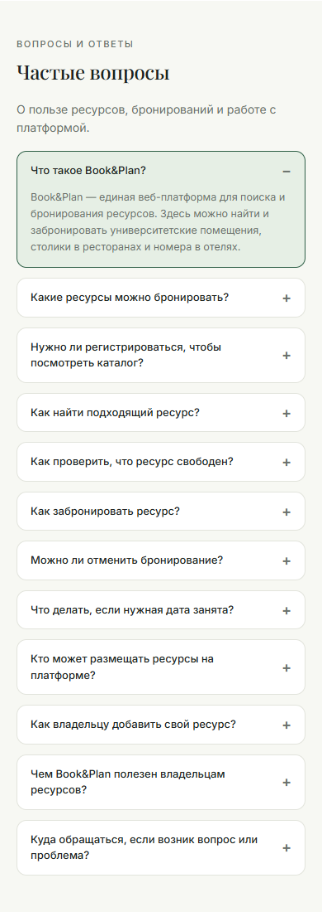
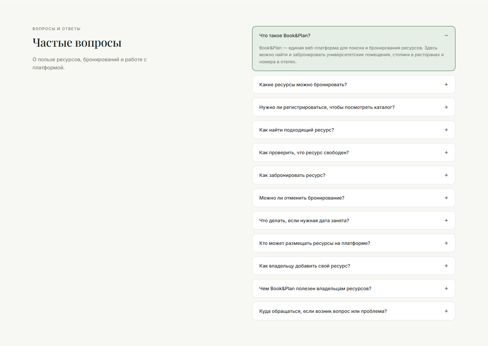

# QA: блок FAQ, TG-142 / TG-143

Проверка завершена 24.11.2026. Тестировщик: Krysin Nikita (martik246).

**Результат:** функциональная проверка FAQ пройдена. Есть два замечания по
текстам и два вопроса для согласования. Это отчёт о тестировании, а не
подтверждение отсутствия замечаний или закрытие задачи разработки.

## Объект и границы проверки

- [TG-142: вёрстка FAQ](http://37.233.80.237:9000/project/bookplan/task/142).
- [TG-143: тестирование лендинга с FAQ](http://37.233.80.237:9000/project/bookplan/task/143).
- Основная ветка `dev`, коммит `fd44f1ae2d039df19776350f842010a980f50f0d`.
- Реализация FAQ из [PR #24](https://github.com/tadreebtech/Book-Plan/pull/24)
  уже принята в `dev`. Файлы фронтенда совпадают с проверенным `e11d6d7`.
- [Макет Figma](https://www.figma.com/design/6JsIEyrU8uNYtxL3VmJVhA/book---plan?node-id=61-2),
  зелёная концепция: положение FAQ, мобильная и настольная композиция;
  [раскрытые ответы, desktop](https://www.figma.com/design/6JsIEyrU8uNYtxL3VmJVhA/book---plan?node-id=147-124),
  [mobile](https://www.figma.com/design/6JsIEyrU8uNYtxL3VmJVhA/book---plan?node-id=148-309).
- Проверена локальная production-сборка в Google Chrome на Windows.
  Это не проверка развёрнутого стенда. Пиксельная идентичность всех размеров,
  Safari/Firefox и физические мобильные устройства не проверялись.
- Тайга при повторном обращении 24.11 не отвечала до истечения времени ожидания.
  Требования взяты из ранее полученных карточек. Текущий статус и новые
  комментарии подтвердить не удалось; статусы задач не изменялись.

## Чек-лист

| Проверка | Результат |
|---|---|
| FAQ находится после финального CTA и до footer | PASS |
| Заголовок «Частые вопросы», 12 вопросов и непустые ответы | PASS |
| Каждый вопрос открывает соответствующий ответ | PASS, все 12 |
| Повторное нажатие закрывает ответ | PASS |
| Открытие другого вопроса закрывает предыдущий | PASS |
| aria-expanded меняется, aria-controls указывает на открытый ответ | PASS |
| Enter и Space открывают/закрывают вопрос в Chrome | PASS |
| Ширины 320, 375, 390, 768, 1024, 1366, 1440, 1920 px | PASS |
| Горизонтальная прокрутка и выход текста ответов за границы | Не обнаружены на проверенных ширинах |
| Две колонки desktop / одна колонка mobile | PASS, структура соответствует макету |
| Необработанные JavaScript-ошибки при проверке | Не обнаружены |
| Тексты и начальное состояние против макета | См. замечания ниже |

Клавиатурное поведение и размеры проверены в настоящем браузере; тесты на
happy-dom не заменяют эти проверки. JSON с результатами:
[faq-check.json](tg142-evidence/faq-check.json).

## Замечания по текстам

### FAQ-01 — опечатка в ответе о занятой дате

Приоритет: низкий. Подтверждено.

1. Открыть FAQ.
2. Нажать «Что делать, если нужная дата занята?».
3. Прочитать первое предложение.

Фактически: «Выберите другую доступное время…».
Ожидается: «Выберите другое доступное время…».
Источник: `frontend/src/data/faqs.ts`, элемент `busy-date`.

### FAQ-02 — вводный текст отличается от макета

Приоритет: низкий. Подтверждено визуальной сверкой с Figma.

1. Открыть FAQ и прочитать текст под заголовком.
2. Сравнить с зелёным макетом FAQ.

Фактически начало текста: «О пользе ресурсов…».
В макете: «О поиске ресурсов…».
Источник: `frontend/src/components/sections/FAQSection.tsx`, `.faq__lead`.
Нужно привести текст к согласованному варианту макета.

## Вопросы для согласования

### FAQ-03 — обещание каталога без регистрации

FAQ утверждает, что каталог, карточки и доступность можно просматривать без
регистрации. В ожидающем принятия [PR #38](https://github.com/tadreebtech/Book-Plan/pull/38)
`CatalogListingListApi` использует `IsAuthenticated`, а существующий тест
`test_listing_endpoints_require_authentication` ожидает 403 для анонимного
запроса к `/api/v1/listings/`.

Это **риск несогласованности при интеграции**, а не подтверждённый дефект
текущего развёрнутого сайта. Проверка серверной тестовой базы PR #38 подтвердила
403. Нужно согласовать публичность каталога и текст FAQ; доступ к карточкам и
календарю отдельно этим результатом не подтверждается. Не следует менять
текст или права доступа без решения по продуктовому требованию.

### FAQ-04 — начальное состояние аккордеона

В основной композиции макета первый ответ раскрыт, остальные закрыты.
В реализации при загрузке закрыты все ответы (`activeId = null`).
Само изображение не определяет поведение при загрузке однозначно:
оно может иллюстрировать состояние после клика. Нужно подтвердить ожидаемое
начальное состояние. В дефекты это без уточнения не переводилось.

## Автоматические проверки в этом MR

Добавлен только `frontend/src/tests/faq.test.tsx`, без изменений продукта,
зависимостей и настроек CI:

- 12 случаев открытия/закрытия реальных вопросов, с проверкой доступности
  кнопки, текста ответа и связи `aria-controls` / `aria-expanded`.
- Переключение между двумя вопросами: одновременно открыт один ответ.
- Проверка полного `App`: 12 вопросов, заголовок и порядок CTA → FAQ → footer.

Локальные результаты на проверенной версии:

| Команда из frontend | Результат |
|---|---|
| `npm test` | 19 passed: 14 новых + 5 существующих |
| `npm run lint` | PASS |
| `npm run typecheck` | PASS |
| `npm run format:check` | PASS |
| `npm run build` | PASS |

Все новые тесты выполняются существующим заданием `frontend` в CI.
Результат удалённого запуска нужно смотреть на странице текущего PR;
локальные результаты не подменяют GitHub CI.

Для воспроизведения: `cd frontend`, `npm ci`, затем команды из таблицы.
Для ручной проверки: `npm run dev`, открыть лендинг, прокрутить к FAQ и
повторить чек-лист на указанных ширинах. Тесты взаимодействия не утверждают
корректность продуктовых обещаний или отсутствие опечаток: замечания выше
остаются открытыми при зелёном результате тестов.

## Скриншоты проверенной сборки

Мобильный экран 390 px, первый вопрос раскрыт вручную:

Настольный экран 1440 px, первый вопрос раскрыт вручную:

